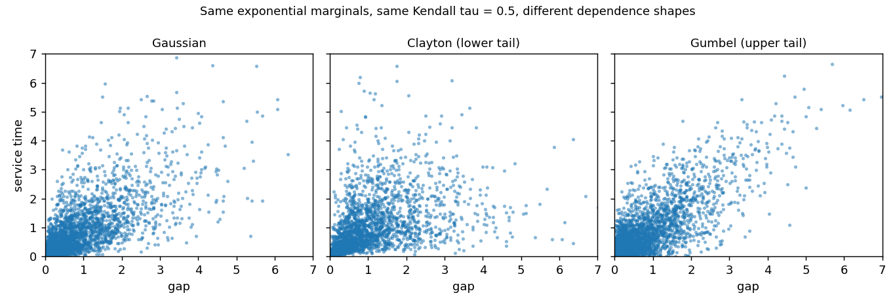
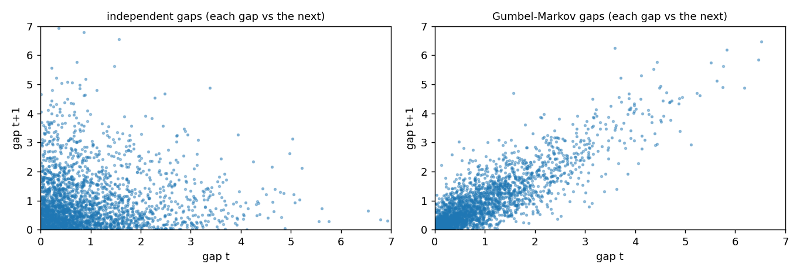

# When Arrivals Aren't Independent: Copulas in SimWeave

*Drawing correlated gaps, job sizes and service times in a discrete-event simulation with `simweave.stats`.*

Most queue simulations draw every random number on its own. The gap to the next customer, the size of the job, the time it takes to serve: each comes from its own distribution, and none of them knows about the others. Real systems are not like that. Big jobs arrive in clusters. A rush is followed by a lull. A long repair follows hard use.

Ignore that and your model can be wrong in a way that no amount of extra Monte Carlo runs will fix. In the example below, two queues receive arrivals with *exactly the same* gap distribution. One takes about 4.4 time units to get through the system. The other takes about 20.

SimWeave 0.9.0 adds `simweave.stats`: copulas, which let you keep the marginal distributions you already know and choose the dependence between them separately. It needs only numpy.

## Table of Contents

- [Why a copula](#why-a-copula)
- [Your first joint draw](#your-first-joint-draw)
- [Dependence has a shape](#dependence-has-a-shape)
- [Correlated gap and service time in a queue](#correlated-gap-and-service-time-in-a-queue)
- [Bursty arrivals with identical marginals](#bursty-arrivals-with-identical-marginals)
- [Fitting a copula to your data](#fitting-a-copula-to-your-data)
- [What this does not do](#what-this-does-not-do)
- [What's next](#whats-next)
- [Try it out yourself](#try-it-out-yourself)

---

## Why a copula

A correlation coefficient tells you how strongly two things move together. It does not tell you *how*. Two pairs of variables can share the same Kendall's tau and still behave very differently where it matters, in the extremes: does a very large job tend to coincide with a very long gap, or does the dependence only show up in the middle?

A **copula** separates the two questions. It is a joint distribution on `[0, 1]` for each variable, with uniform margins, that carries only the dependence. You then push each coordinate through the inverse CDF of whatever marginal you like:

```
(U1, U2) ~ copula            # dependence only
gap  = Exponential.ppf(U1)   # your marginal for gaps
size = LogNormal.ppf(U2)     # your marginal for sizes
```

So you can say "exponential gaps, lognormal sizes, Kendall tau 0.6 with upper-tail dependence" without redoing any of your marginal fitting.

Plain correlation is enough when everything is roughly normal. Copulas are what you reach for when the marginals are skewed (waiting and service times nearly always are) or when the tails matter.

---

## Your first joint draw

```python
import numpy as np
import simweave as sw
from simweave.stats import Exponential, LogNormal, JointSampler, kendall_tau

rng = np.random.default_rng(42)

joint = JointSampler(
    sw.GumbelCopula.from_kendall_tau(0.6),
    {"interarrival": Exponential(1.0), "size": LogNormal.from_mean_cv(2.0, 0.5)},
)
x = joint.sample(rng, 50_000)          # dict of arrays
print("mean gap", round(x["interarrival"].mean(), 3), "mean size", round(x["size"].mean(), 3))
print("kendall tau", round(kendall_tau(x["interarrival"][:10_000], x["size"][:10_000]), 3))
```

```
mean gap 1.002 mean size 1.999
kendall tau 0.595
```

The marginals come out as asked (means of about 1 and 2) and the dependence is the requested 0.6. Inside a simulation you call `joint.draw(rng)` instead, which returns one `{"interarrival": ..., "size": ...}` dict at a time.

The marginals in `simweave.stats` are `Exponential`, `Uniform`, `Normal`, `LogNormal`, `Weibull`, `Deterministic` and `Empirical(data)`, plus a wrapper for any frozen `scipy.stats` distribution. The existing `sw.exponential(...)` helpers work as marginals too.

---

## Dependence has a shape

SimWeave ships five copula families. They differ in where the dependence lives:

| Copula | Tail dependence | Extra requirement |
|---|---|---|
| `GaussianCopula` | none | none |
| `ClaytonCopula` | lower tail | none |
| `GumbelCopula` | upper tail | none |
| `FrankCopula` | none (symmetric) | none |
| `StudentTCopula` | both tails | scipy |

Each has `from_kendall_tau(tau)`, and `tail_dependence()` reports the tail coefficients:

```python
for name, c in [("gaussian", sw.GaussianCopula.from_kendall_tau(0.5)),
                ("clayton", sw.ClaytonCopula.from_kendall_tau(0.5)),
                ("gumbel", sw.GumbelCopula.from_kendall_tau(0.5))]:
    td = c.tail_dependence()
    print(f"{name:9s} lower {td['ll']:.2f}  upper {td['uu']:.2f}")
```

```
gaussian  lower 0.00  upper 0.00
clayton   lower 0.71  upper 0.00
gumbel    lower 0.00  upper 0.59
```

Same Kendall tau of 0.5 in all three, very different behaviour in the corners.

{ width=720 }

!!! tip "Visualising a copula"
    Draw `copula.sample_u(n, rng)`, push both columns through your marginals' `ppf`, and scatter them. The figure above is exactly that. Clayton piles points into the lower left corner (small gap with small service time together). Gumbel stretches a tail up the right.

**Negative dependence.** The Clayton, Gumbel and Frank copulas model positive dependence. For negative dependence, or to put the tail where you want it, reflect an axis:

```python
g = sw.GumbelCopula.from_kendall_tau(0.5)
neg = g.flipped((1,))              # reflect the second variable
print(neg.kendall_tau())           # -0.5
print(neg.tail_dependence())       # ul = 0.586: first variable high with the second low
```

`.survival()` reflects every axis, swapping lower and upper tails.

---

## Correlated gap and service time in a queue

Now put a copula inside a simulation. `ArrivalGenerator` takes a `joint` sampler; its factory receives the whole joint draw, and `EntityProperties.from_draw` turns the drawn service time into a fixed service time for that entity.

```python
def factory(env, draw):
    job = sw.Entity()
    job.sim_properties = sw.EntityProperties.from_draw(draw)   # draw["service_time"] -> service time
    return job

joint = JointSampler(
    sw.GumbelCopula.from_kendall_tau(0.5).flipped((0,)),
    {"interarrival": Exponential(1.0), "service_time": Exponential(0.8)},
)
env = sw.SimEnvironment(dt=0.05)
service = sw.Service(capacity=1, buffer_size=100_000, rng=rng)
env.register(sw.ArrivalGenerator(None, factory, service, rng=rng, joint=joint,
                                 gap_alignment="after"))
env.register(service)
env.run(4000.0)
print(service.average_residence())
```

Existing code is unaffected: without `joint`, `ArrivalGenerator` behaves exactly as before. The generator draws from its own child random stream, seeded from `rng`, so adding a copula does not disturb your other draws.

**Which entity gets the attribute?** `gap_alignment` answers that. With `"after"`, the attributes drawn with a gap belong to the entity just created and the gap is the time until the *next* arrival, so you can model "a big job is followed by a short gap". With the default `"before"`, the attributes go to the entity that arrives after the gap, so they relate to the time since the last arrival.

Demo 31 compares the families on one queue (a single server, mean gap 1.0, mean service 0.8, so 80% utilisation). The service time and the gap that follows are negatively dependent with Kendall tau -0.5, so big jobs tend to be followed by short gaps. Twelve replicates of 4000 time units each give the mean time in the system:

| Dependence | Time in system (95% CI) |
|---|---|
| independent | 4.36 ± 0.26 |
| Gaussian | 6.47 ± 0.49 |
| Clayton (flipped) | 6.96 ± 0.61 |
| Gumbel (flipped) | 7.19 ± 0.96 |
| Student-t | 6.87 ± 0.86 |

Read that table carefully. **Adding dependence moves the answer a lot**: about 4.4 becomes 6.5 to 7.2. The *family* matters much less than that. The intervals for Gaussian, Clayton, Gumbel and Student-t overlap, so at this load and with exponential marginals you could not honestly rank them. Tail shape should matter more with heavier-tailed service times, higher utilisation, or a finite buffer where overflow probabilities depend on the extremes, but this post does not test that, so measure it for your own case. If you only remember one thing from this section: modelling the dependence at all is the big step.

---

## Bursty arrivals with identical marginals

The second kind of dependence is across time: a short gap tends to be followed by another short gap. `MarkovCopulaProcess` produces a sequence whose every value has the marginal you choose, while consecutive values have the copula's dependence. It is a plain callable, so it drops into the `interarrival` slot with no other changes.

```python
from simweave.stats import MarkovCopulaProcess

proc = MarkovCopulaProcess(sw.GumbelCopula.from_kendall_tau(0.6), Exponential(1.0))
gaps = proc.sample(np.random.default_rng(3), 20_000)
print("mean", round(gaps.mean(), 3), "lag-1 tau", round(kendall_tau(gaps[:-1], gaps[1:]), 3))
short = gaps[:-1] < 0.2
print("P(short gap next | short gap now)", round(float(np.mean(gaps[1:][short] < 0.2)), 3),
      "vs overall", round(float(np.mean(gaps < 0.2)), 3))
```

```
mean 0.985 lag-1 tau 0.604
P(short gap next | short gap now) 0.594 vs overall 0.192
```

{ width=720 }

A short gap is followed by another short gap about 59% of the time, against 19% for independent gaps. The histogram of gaps is the same exponential either way. Only their order differs.

Demo 30 runs the queue both ways (utilisation 80%, eight replicates of 4000 time units):

| Gaps | Lag-1 tau | Time in system |
|---|---|---|
| independent | +0.00 | 4.41 ± 0.21 |
| serially dependent | +0.60 | 19.84 ± 1.47 |

Same marginal gaps, about 4.5 times the time in the system. This is the quiet danger of fitting only the marginal: a gap histogram alone cannot tell you whether arrivals come in bursts.

!!! warning "Build the process per replicate"
    A `MarkovCopulaProcess` carries state (the previous value). Create it inside your scenario function, not outside, so every Monte Carlo replicate gets its own. Call `reset()` to restart one.

---

## Fitting a copula to your data

If you have logs, `fit_copula` estimates the dependence from ranks, so your marginals do not matter. It inverts Kendall's tau for each family and ranks the candidates by AIC:

```python
data = sw.GumbelCopula.from_kendall_tau(0.6).flipped((1,)).sample_u(3000, np.random.default_rng(1))
fit = sw.fit_copula(data)
print(fit.family, round(fit.tau, 3))
for row in fit.table[:4]:
    print(row["family"], round(row["aic"], 1))
```

```
gumbel (axis 1 flipped) -0.606
gumbel -3420.1
t -3191.7
clayton_survival -3114.5
gaussian -3067.8
```

It finds the Gumbel family with a flipped axis (negative dependence) and a tau of about -0.6. Lower AIC is better. To go straight from observations to a simulation input:

```python
joint = sw.JointSampler.from_data(observations, ["interarrival", "size"])
```

This uses empirical marginals and the fitted copula. Use `method="mle"` in `fit_copula` to refine the parameter by maximum likelihood (needs scipy). One caveat applies to any copula selection: with a few hundred points, several families will fit about equally well. Check the tail you care about rather than trusting the ranking.

---

## What this does not do

Being honest about the edges:

- **Bivariate for most things.** Fitting, the tail coefficients and the serial process work on pairs. Gaussian and Student-t copulas of higher dimension can be sampled and fitted; Clayton, Gumbel and Frank samplers work in any dimension but are exchangeable (every pair has the same dependence).
- **Lag-1 serial dependence only.** The Markov chain captures dependence between neighbouring values. Longer memory needs more machinery.
- **Tick resolution still applies.** `ArrivalGenerator` works on simulation ticks, so very short gaps are rounded to the tick as before. Keep `dt` well below your smallest gap if the lower tail matters.
- **Student-t and maximum-likelihood fitting need scipy.** Everything else works on a numpy-only install, and `import simweave` never imports scipy. Install `simweave[optim]` for the rest.
- **No vine copulas**, and no copula parameters that change over time.

---

## What's next

The design note ([Copula sampling](../design/copulas.md)) lists what comes after this release:

- **Common-cause failures in fleets.** Dependent component lifetimes in `simweave.reliability`, so one bad week can take several vehicles out together.
- **Demand and lead time in supply chains.** A sampler hook on the warehouse so demand and supplier delay can be correlated, and a simulation-based safety-stock estimate.
- **Hybrid operations.** Payload, flight time and arrival gap together for a delivery drone, joining this with the [flight module](quadcopter-flight.md).

---

## Try it out yourself

Run every snippet in this post in your browser, with no install required:

[](https://mybinder.org/v2/gh/Notabot123/simweave-notebooks/HEAD?labpath=07_copulas_dependence.ipynb)

The notebook lives in the companion repository, [simweave-notebooks](https://github.com/Notabot123/simweave-notebooks). The scripts behind the queue results are in the library's `demos` folder: `30_serial_dependence_queue.py` and `31_copula_families_queue.py`.

Install the library with the optional extras if you want the Student-t copula or plots:

```bash
pip install "simweave[viz,optim]"
```
