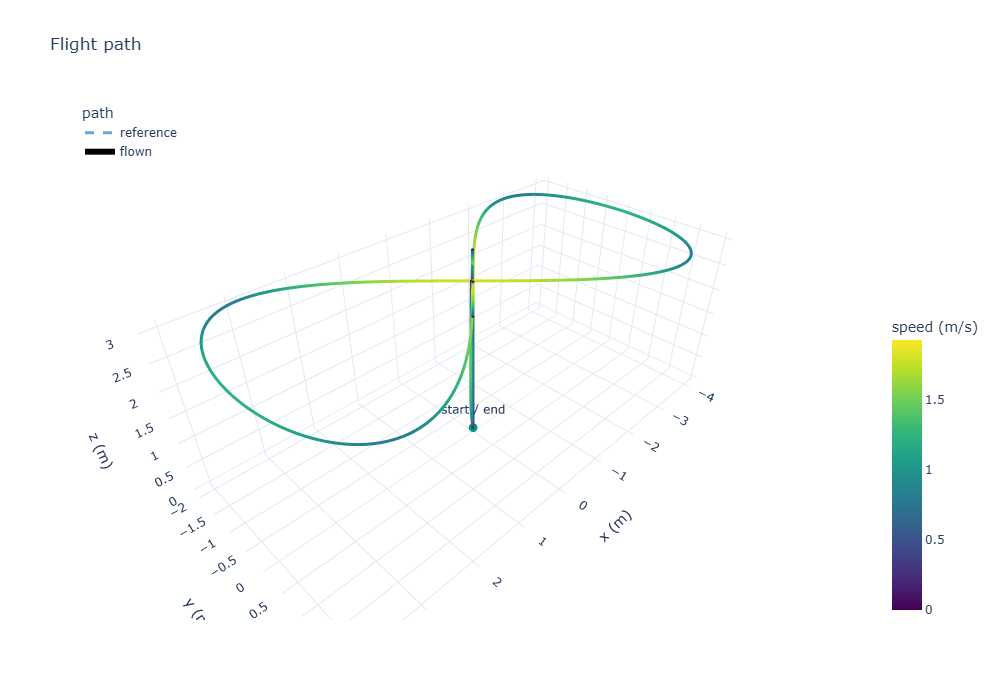
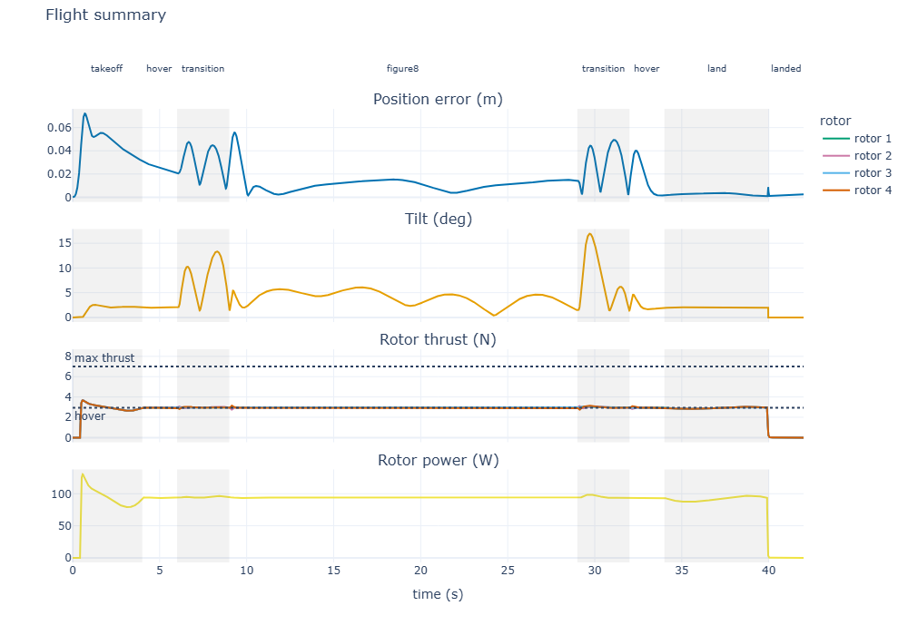
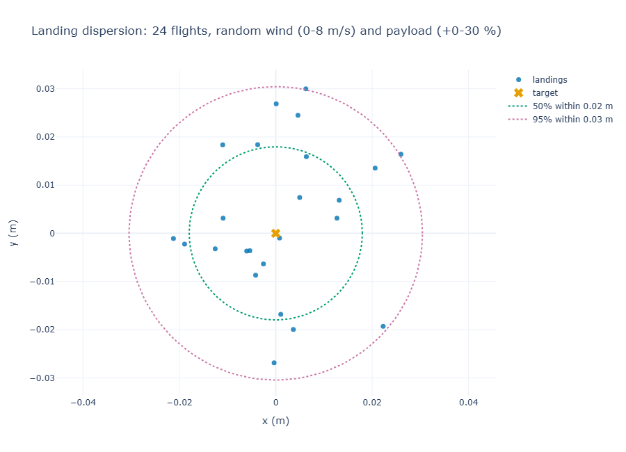
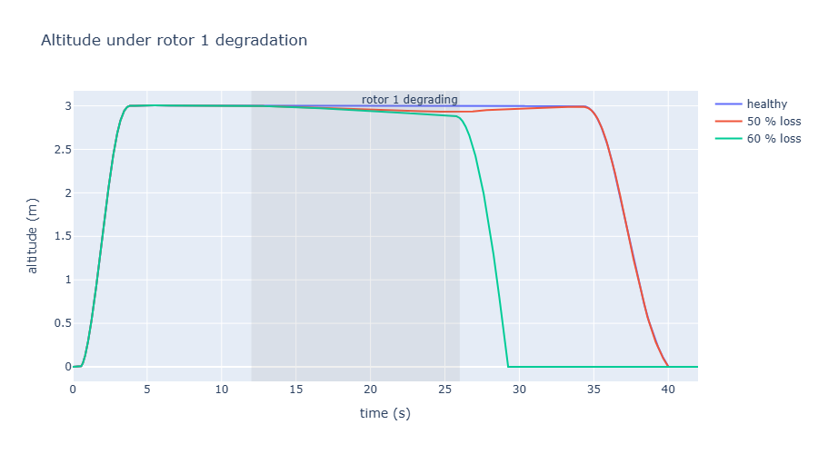

# Flying a Quadcopter in Simulation: Take-off, Figure-8, Landing

*Simulating a multirotor with SimWeave's `flight` module: closed-loop control, missions, wind, payload surprises and failing motors.*

A drone that works in a demo and a drone that works on a windy Tuesday with a parcel it was never told about are different machines. Finding out which one you have by flying it costs batteries, propellers and sometimes a roof. Finding out in simulation costs a few seconds of CPU.

SimWeave's `simweave.flight` module gives you a quadcopter you can fly in Python: a physical model, a cascaded flight controller, missions (take off, figure-8, land), wind, and the hooks to inject motor faults and run Monte Carlo campaigns. It needs only numpy, and because it is built on SimWeave's continuous solver it shares a clock with the discrete-event parts of the library.

## Table of Contents

- [Why simulate flight](#why-simulate-flight)
- [The vehicle in one screen](#the-vehicle-in-one-screen)
- [Your first mission](#your-first-mission)
- [How the controller works](#how-the-controller-works)
- [Seeing the flight](#seeing-the-flight)
- [Wind, payloads and weak motors](#wind-payloads-and-weak-motors)
- [Monte Carlo: where will it land?](#monte-carlo-where-will-it-land)
- [When a motor fails](#when-a-motor-fails)
- [What this model leaves out](#what-this-model-leaves-out)
- [What's next](#whats-next)
- [Try it out yourself](#try-it-out-yourself)

---

## Why simulate flight

Three questions come up again and again with small multirotors, and all of them are cheaper to answer in software first:

- **Does the controller track the path?** And how badly does it degrade when conditions change?
- **How much margin do I have?** Thrust, battery, tilt: where is the cliff?
- **What happens when something breaks?** A weakened motor is not a hypothetical, it is a Tuesday.

Heavyweight tools exist for this. Autopilot software-in-the-loop setups such as PX4 with Gazebo run the real flight firmware against a 3D physics world, which is the right choice when you are validating a specific autopilot. Physics-engine environments such as `gym-pybullet-drones` are popular for reinforcement-learning work. Both are substantial installs with a lot of moving parts.

`simweave.flight` aims at a different spot: a small, readable, fast model that you can drop into a notebook, a Monte Carlo loop, or a larger simulation of a delivery operation. It is honest about what it simplifies (see [What this model leaves out](#what-this-model-leaves-out)), and it does not pretend to replace firmware-in-the-loop testing.

---

## The vehicle in one screen

The `Quadrotor` is a rigid body with four rotors in an "X" layout. Its state has 16 entries:

| Entries | Meaning |
|---|---|
| `x y z`, `vx vy vz` | position and velocity, world frame, **Z up** |
| `roll pitch yaw` | ZYX Euler angles (positive pitch is nose down) |
| `p q r` | body rates |
| `f1 f2 f3 f4` | actual rotor thrusts, which lag the commanded thrusts with a time constant (`motor_tau`, 30 ms by default) |

The input is the four commanded rotor thrusts, in newtons. Drag acts on the velocity relative to the air, so wind pushes the vehicle. The default parameters describe a 1.2 kg sport quad:

```python
from simweave.flight import Quadrotor

quad = Quadrotor()
print("hover thrust per rotor", round(quad.hover_thrust, 3), "N")
print("max thrust per rotor  ", quad.max_thrust, "N")
print("thrust-to-weight      ", round(quad.params.thrust_to_weight, 2))
```

```text
hover thrust per rotor 2.943 N
max thrust per rotor   7.0 N
thrust-to-weight       2.38
```

A `Mixer` turns what a controller wants (total thrust and three body torques) into four rotor thrusts that stay within limits. When a request does not fit, it gives up collective thrust before it gives up attitude torque, because a vehicle that is the wrong way up is worse off than one that is slowly sinking:

```python
import numpy as np
from simweave.flight import Mixer

mixer = Mixer(quad.params)
print(np.round(mixer.allocate(quad.params.weight, (0.0, 0.0, 0.0)), 3))
print(np.round(mixer.allocate(quad.params.weight, (0.02, 0.0, 0.0)), 3))
```

```text
[2.943 2.943 2.943 2.943]
[2.901 2.985 2.985 2.901]
```

The first call is plain hover. The second asks for a small roll torque, so the left rotors push a little harder than the right.

---

## Your first mission

A `Mission` is a chain of segments. `Mission.figure8` builds the classic: climb, hover, blend into a figure-8, fly it, blend out, hover, and land softly. Every join is continuous in position, velocity and acceleration, so the controller is never asked to follow an impossible jump.

```python
from simweave.flight import Mission, Quadrotor, fly

mission = Mission.figure8(height=3.0, a=4.0, b=2.0, period=20.0)
for name, start, end in mission.phases:
    print(f"{name:<10s} {start:5.1f} -> {end:5.1f} s")

flight = fly(Quadrotor(), mission)
print({k: round(v, 3) for k, v in flight.metrics().items()})
```

```text
takeoff      0.0 ->   4.0 s
hover        4.0 ->   6.0 s
transition   6.0 ->   9.0 s
figure8      9.0 ->  29.0 s
transition  29.0 ->  32.0 s
hover       32.0 ->  34.0 s
land        34.0 ->  40.0 s
landed      40.0 ->  42.0 s
{'rms_error': 0.018, 'max_error': 0.072, 'max_tilt_deg': 15.594, 'saturation_fraction': 0.0, 'energy_wh': 1.027, 'duration': 42.0, 'touchdown_speed': -0.397, 'landing_error': 0.001}
```

A 42 second flight tracks its reference to 1.8 cm RMS, never leans more than about 16 degrees, touches down at 0.4 m/s and uses about a watt-hour of rotor energy. `flight.phase_rms()` breaks the error down by phase:

```python
print({k: round(v, 3) for k, v in flight.phase_rms().items()})
```

```text
{'takeoff': 0.025, 'hover': 0.016, 'transition': 0.032, 'figure8': 0.013, 'land': 0.003, 'landed': 0.001}
```

The figure-8 itself is the easy part (1.3 cm). The vehicle struggles most when it lifts off and when it accelerates into the loop.

The results come in two shapes. `flight.to_dict()` gives columns `time, x, y, z, roll, pitch, yaw` first (Z up, radians) followed by velocities, rates and rotor thrusts, and `flight.to_frame()` returns the same as a pandas DataFrame if pandas is installed. `flight.to_viewer()` maps the same data to a Y-up convention for 3D viewers, which is how this simulation can drive a model in a web-based viewer.

---

## How the controller works

`fly` builds a `CascadedController`, the structure almost every real multirotor uses: outer loops decide where to go, inner loops decide how to lean and spin.

```text
reference (position, velocity, acceleration, heading)
  position P            -> velocity setpoint (speed limited)
  velocity PI           -> desired acceleration
  thrust vector         -> total thrust and the direction the vehicle must point
  attitude error        -> body-rate setpoint
  rate PI               -> body torques
  mixer                 -> four rotor thrusts
```

The key idea is the thrust-vector step. A quadcopter can only push along its own "up" axis, so to accelerate sideways it must lean. The controller works out the thrust vector needed (`mass * (acceleration + gravity)`), points the vehicle along it, and takes the total thrust from the part that lines up with the vehicle's current axis. A 35 degree tilt limit keeps the request sane.

The controller is a *sampled-data* controller, like real firmware: it runs at a fixed rate (here 125 Hz) and holds its output constant while the physics integrates in finer steps. SimWeave's solver supports this directly, so you can use the pieces yourself:

```python
from simweave.continuous import simulate
from simweave.flight import CascadedController, Mission, Quadrotor

quad = Quadrotor()
mission = Mission.figure8()
ctrl = CascadedController(mission, quad.params)

result = simulate(quad, (0.0, mission.duration), dt=0.004,
                  controller=ctrl, control_dt=0.008)
print(result.state.shape, result.state_labels[:6], "final z", round(float(result.state[-1, 2]), 3))
```

```text
(10501, 16) ('x', 'y', 'z', 'vx', 'vy', 'vz') final z 0.0
```

`controller=` accepts anything with an `update(t, state, dt)` method returning the input, so the same hook works for your own control law, or for the PID controller from `simweave.continuous.control` on a simpler plant.

!!! tip "Tuning"
    All gains and limits live in `ControllerGains`. Rate-loop gains act on angular acceleration, so they do not need rescaling when you change the vehicle's inertia.

---

## Seeing the flight

Two plot helpers take a flight directly. Both return Plotly figures, so `fig.show()`, `fig.write_html(...)` and `fig.to_json()` all work.

```python
from simweave.flight import ConstantWind
from simweave.viz import plot_trajectory_3d, plot_flight_summary

flight = fly(Quadrotor(wind=ConstantWind((4.0, 0.0, 0.0))), mission)
plot_trajectory_3d(flight).show()
plot_flight_summary(flight).show()
```

<figure markdown>
  { width=640 }
</figure>
*The figure-8 flown in a steady 4 m/s wind, coloured by speed. The vertical line is the take-off and landing.*

<figure markdown>
  { width=640 }
</figure>
*Four panels over time, with mission phases shaded. The error peaks as the vehicle lifts off, and the rotors sit just above hover thrust throughout.*

!!! tip "What to look for"
    The rotor panel shows the thrust limit and the hover thrust as dotted lines. The gap between your rotors and the top line is your margin. When a flight goes wrong, this is the panel that shows why.

---

## Wind, payloads and weak motors

The controller models the vehicle with `vehicle.params`. If you change the vehicle afterwards, the controller does not know, which is exactly the situation in a real deployment: a parcel you did not weigh, a motor that is wearing out. The integral terms are supposed to absorb it, and this is how you check:

```python
from simweave.flight import ConstantWind, GustWind, Mission, Quadrotor, fly

mission = Mission.figure8()

def run(quad):
    m = fly(quad, mission).metrics()
    return m["rms_error"], m["max_error"], m["energy_wh"]

heavy = Quadrotor()
heavy.mass *= 1.25          # a payload the controller does not know about

weak = Quadrotor()
weak.motor_eff_1 = 0.8      # rotor 1 delivers only 80 % of commanded thrust

cases = {
    "nominal": Quadrotor(),
    "5 m/s steady wind": Quadrotor(wind=ConstantWind((5.0, 0.0, 0.0))),
    "6 m/s gust": Quadrotor(wind=GustWind((6.0, 0.0, 0.0), start=15.0, duration=3.0)),
    "payload +25 %": heavy,
    "rotor 1 at 80 %": weak,
}
for name, quad in cases.items():
    print(name, run(quad))
```

| Case | RMS error (m) | Max error (m) | Energy (Wh) |
|---|---|---|---|
| Nominal | 0.018 | 0.072 | 1.03 |
| 5 m/s steady wind | 0.025 | 0.072 | 1.03 |
| 6 m/s gust at t = 15 s | 0.023 | 0.087 | 1.03 |
| Payload +25 % (unknown) | 0.061 | 0.239 | 1.44 |
| Rotor 1 at 80 % | 0.035 | 0.148 | 1.13 |

Wind barely matters: the vehicle leans into it and the integral terms cancel it. The payload costs the most, both in accuracy (the controller has to discover the extra weight through its integrators) and in energy, which grows with mass to the power 1.5 (momentum theory). All of them land softly.

---

## Monte Carlo: where will it land?

`fly` is an ordinary function of a vehicle and a mission, so it drops straight into SimWeave's Monte Carlo runner. Demo 28 flies the mission 24 times with a random steady wind (0 to 8 m/s from any direction), seeded turbulence, and an unknown payload between 0 and 30 % extra:

```python
import numpy as np
from simweave.flight import Mission, Quadrotor, TurbulentWind, fly
from simweave.mc import run_monte_carlo

MISSION = Mission.figure8(height=3.0, period=20.0)

def scenario(seed):
    rng = np.random.default_rng(seed)
    speed, heading = rng.uniform(0, 8), rng.uniform(0, 2 * np.pi)
    wind = TurbulentWind(
        sigma=1.0, correlation_time=1.5, duration=MISSION.duration + 1.0,
        mean=(speed * np.cos(heading), speed * np.sin(heading), 0.0), rng=rng,
    )
    quad = Quadrotor(wind=wind)
    quad.mass *= rng.uniform(0.9, 1.3)
    td = fly(quad, MISSION).touchdown()
    return [td["x"], td["y"], td["vertical_speed"]]

mc = run_monte_carlo(scenario, n_runs=24, executor="processes")
```

The full script is `demos/28_quadcopter_wind_montecarlo.py`. Across the 24 flights:

```text
RMS tracking error  median 0.037 m, worst 0.078 m
Touchdown speed     median -0.34 m/s, hardest -0.66 m/s
Landing miss        50% within 0.02 m, 95% within 0.03 m
Rotor energy        1.17 Wh on average (0.90-1.51)
```

<figure markdown>
  { width=640 }
</figure>
*24 landings, with circles containing 50 % and 95 % of them (`plot_landing_dispersion`).*

!!! example "Define the scenario at module level"
    With `executor="processes"` the scenario function is pickled and sent to worker processes, so it must be defined at the top level of a module, not inside another function. Each replicate builds its own generator from its seed, so the whole campaign is reproducible.

Twenty-four flights is a demonstration, not a certification: the point is that the whole campaign takes seconds, so you can run hundreds.

---

## When a motor fails

A `FaultInjector` wraps the quadrotor and perturbs a named parameter over time, exactly as it does for the thermal and mechanical models in the predictive maintenance post. Each rotor's thrust scale is exposed as `motor_eff_1` to `motor_eff_4`, so degrading one rotor is a few lines:

```python
from simweave.faults import FaultInjector, FaultProfile, ParameterFault

profile = FaultProfile(onset_time=12.0, failure_time=26.0,
                       mode="rotor_degradation", shape="linear")
fault = ParameterFault(param="motor_eff_1", profile=profile, max_delta=-0.5)

flight = fly(FaultInjector(Quadrotor(), [fault]), mission)
```

Rotor 1 loses 50 % of its thrust between 12 and 26 seconds. The controller has no idea, but its integrators push that rotor harder, and the others compensate. Compare three flights, with the loss at 0 %, 50 % and 60 %:

| Case | RMS error (m) | Max error (m) | Time saturated | Energy (Wh) | Outcome |
|---|---|---|---|---|---|
| Healthy | 0.018 | 0.07 | 0 % | 1.03 | lands at 0.40 m/s |
| 50 % loss | 0.072 | 0.18 | 0 % | 1.25 | lands at 0.31 m/s |
| 60 % loss | 1.331 | 3.02 | 36 % | 1.33 | crash |

<figure markdown>
  { width=640 }
</figure>
*Altitude for the three flights. The shaded band is when rotor 1 is degrading.*

There is a clean explanation for the cliff between 50 % and 60 %. To hover, the weakened rotor must still deliver `hover thrust` (2.94 N), so its command must be `2.94 / efficiency`. The rotor tops out at 7 N, so the limit is reached at an efficiency of about 0.42, a loss of 58 %. Below that, no controller can hold the vehicle. For the default vehicle that margin is `1 - hover_thrust / max_thrust`:

```python
q = Quadrotor()
print(round(1 - q.hover_thrust / q.max_thrust, 2))
```

```text
0.58
```

!!! tip "Why this matters for predictive maintenance"
    Up to the cliff the flight looks fine from the outside: error stays at a few centimetres, but the energy used over the mission is about 20 % higher and one rotor is working much harder than the others. Those are exactly the signals a health-monitoring model would watch.

---

## What this model leaves out

Honest limits, so you know when to trust it:

- **Perfect sensing.** The controller sees the true state. There is no IMU noise, GPS error or state estimator, which matters a lot on real aircraft.
- **Simple aerodynamics.** Drag acts on the air-relative velocity. There is no blade flapping, rotor inflow, ground effect or propeller wash.
- **Euler angles.** The attitude kinematics are singular at 90 degrees of pitch, so the mission is tilt-limited and flips are out of scope.
- **Idealised rotors.** A first-order thrust lag and a thrust limit, with no battery sag or motor electrical model. The energy estimate uses momentum theory with a fixed figure of merit.
- **A friendly controller.** The cascade is well-behaved, but it is a reference design, not the firmware on your drone. If you need to validate a specific autopilot, use its own software-in-the-loop setup.

---

## What's Next

- **A SimWeave node in EdgeWeave.** `to_viewer()` already produces the columns that EdgeWeave's 3D viewer expects, so a simulated flight can replace the hard-coded drone path in the demo.
- **Wider flight dynamics.** A quaternion-based six degrees of freedom base, an atmosphere model and a fixed-wing vehicle are planned, built from what this module taught us rather than designed in advance.
- **Hybrid operations.** A delivery drone is a continuous flight inside a discrete operation. Orders arrive, a drone flies for the time the physics says it takes, and then it recharges. SimWeave's `ContinuousProcess` already lets the two share a clock.

---

## Try it out yourself

Run every snippet in this post in your browser, with no install required:

[](https://mybinder.org/v2/gh/Notabot123/simweave-notebooks/HEAD?labpath=06_quadcopter_flight.ipynb)

The notebook lives in the companion repository, [simweave-notebooks](https://github.com/Notabot123/simweave-notebooks). The scripts used in this post are also in the library's `demos` folder: `27_quadcopter_figure8.py`, `28_quadcopter_wind_montecarlo.py` and `29_quadcopter_motor_fault.py`.

Install the library with the plotting extra:

```bash
pip install "simweave[viz]"
```
